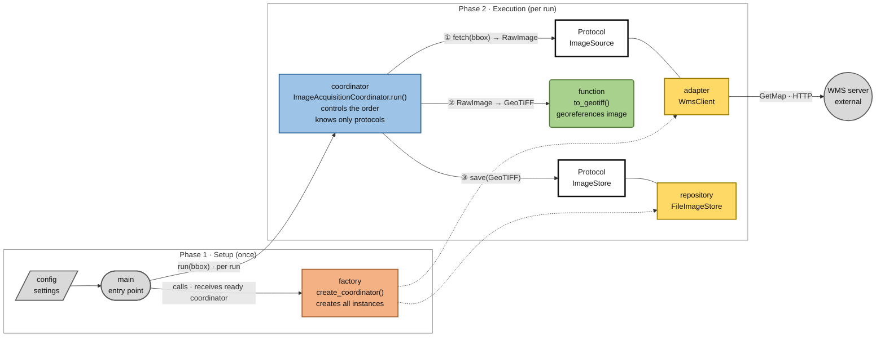

# Code Architecture: Roles and Their Interaction

Overview of typical units, their responsibilities and how they interact. Code examples in Python.

---

## 1. Roles

### Entry

| Role | Responsibility | Does not contain |
|---|---|---|
| **main** | Entry point: load configuration, wire objects together, start the flow | Business logic |
| **handler / listener** | React to events (requests, messages, UI events); pass them on to coordinator or service | Flow control, business logic |

### Control

| Role | Responsibility | Does not contain |
|---|---|---|
| **coordinator** | Flow control: which steps run in which order | Own computations; delegates to others |

Related names: orchestrator, controller, manager.

### Creation and Structure

| Role | Responsibility | Does not contain |
|---|---|---|
| **factory** | Object creation: construction, dependencies, choice of implementation | Flow or business logic |
| **interface / protocol** | Contracts between components (see section 2) | Implementation |
| **config** | Central collection of settings | Logic; constants scattered across the code |

### Business Logic

| Role | Responsibility | Does not contain |
|---|---|---|
| **function** | Concrete unit of work: one clearly defined task | Knowledge of the overall flow |
| **service** | Business logic not tied to a single entity; domain-oriented rather than flow-oriented | Ordering of the overall flow (→ coordinator) |
| **model / entity** | Domain objects with their own rules (e.g. `Order`, `Customer`) | Storage or transport details |
| **validator** | Validation of inputs and states | Modification of the validated data |

### Data and External Access

| Role | Responsibility | Does not contain |
|---|---|---|
| **repository** | Loading and storing data (database, files); encapsulates storage details | Business rules |
| **adapter / gateway / client** | Connection to external systems (APIs, message brokers); translation of foreign formats | Business logic |
| **mapper / DTO** | Conversion between layers; DTOs are plain data containers | Behavior (DTO); business decisions (mapper) |

### Cross-Cutting

| Role | Responsibility | Does not contain |
|---|---|---|
| **utils / helpers** | Domain-agnostic helper functions | Domain specifics; keep small to avoid a dumping ground |

---

## 2. Protocols

### Purpose
A `Protocol` (module `typing`, Python 3.8+) defines a **contract over methods and attributes** without requiring implementations to inherit from it. It uses **structural typing** ("duck typing" with static checking): any class with matching methods satisfies the protocol automatically.

### Protocol vs. ABC (Abstract Base Class)

| Aspect | `Protocol` | `ABC` |
|---|---|---|
| Typing | structural | nominal (inheritance required) |
| Inheritance required | no | yes |
| Checking | static (mypy, pyright); at runtime only with `@runtime_checkable` | at runtime on instantiation |
| Third-party code usable | yes, unchanged | only via subclass/wrapper |
| Shared implementation | uncommon | possible |

**Rule of thumb:** `Protocol` for lean contracts and loose coupling; `ABC` when shared base logic should be inherited or runtime enforcement is desired.

### Example

```python
from typing import Protocol, runtime_checkable
from dataclasses import dataclass


# --- model ---------------------------------------------------------
@dataclass
class Order:
    id: int
    amount: float


# --- protocols (contracts) -----------------------------------------
class OrderRepository(Protocol):
    def get(self, order_id: int) -> Order: ...
    def save(self, order: Order) -> None: ...


@runtime_checkable
class Notifier(Protocol):
    def send(self, message: str) -> None: ...


# --- repository (implementation, no inheritance) -------------------
class InMemoryOrderRepository:
    def __init__(self) -> None:
        self._data: dict[int, Order] = {}

    def get(self, order_id: int) -> Order:
        return self._data[order_id]

    def save(self, order: Order) -> None:
        self._data[order.id] = order


# --- adapter -------------------------------------------------------
class ConsoleNotifier:
    def send(self, message: str) -> None:
        print(message)


# --- function ------------------------------------------------------
def apply_discount(order: Order, rate: float) -> Order:
    return Order(order.id, round(order.amount * (1 - rate), 2))


# --- coordinator ---------------------------------------------------
class DiscountCoordinator:
    def __init__(self, repo: OrderRepository, notifier: Notifier) -> None:
        self._repo = repo
        self._notifier = notifier

    def run(self, order_id: int, rate: float) -> None:
        order = self._repo.get(order_id)                # ①
        updated = apply_discount(order, rate)           # ②
        self._repo.save(updated)                        # ③
        self._notifier.send(f"Order {updated.id}: {updated.amount}")  # ④


# --- config --------------------------------------------------------
@dataclass
class Config:
    discount_rate: float = 0.1


# --- factory -------------------------------------------------------
def create_coordinator() -> DiscountCoordinator:
    repo = InMemoryOrderRepository()
    repo.save(Order(1, 100.0))                          # sample data
    notifier = ConsoleNotifier()
    return DiscountCoordinator(repo, notifier)


# --- main ----------------------------------------------------------
def main() -> None:
    cfg = Config()                                      # load config
    coordinator = create_coordinator()                  # Phase 1: setup
    coordinator.run(order_id=1, rate=cfg.discount_rate) # Phase 2: execution


if __name__ == "__main__":
    main()
```

### Use in Tests

```python
class FakeNotifier:
    def __init__(self) -> None:
        self.messages: list[str] = []

    def send(self, message: str) -> None:
        self.messages.append(message)


def test_discount() -> None:
    repo = InMemoryOrderRepository()
    repo.save(Order(1, 100.0))
    notifier = FakeNotifier()

    DiscountCoordinator(repo, notifier).run(1, 0.1)

    assert repo.get(1).amount == 90.0
    assert notifier.messages == ["Order 1: 90.0"]
```

`FakeNotifier` satisfies the `Notifier` protocol without inheritance and without a mocking library.

### Runtime Check

```python
isinstance(ConsoleNotifier(), Notifier)  # True – only thanks to @runtime_checkable
```

Limitation: `isinstance` only checks that the methods **exist**, not their signatures or return types.

### Recommendations
- Define protocols **at the consumer** (e.g. in the coordinator's module), not at the implementation.
- Keep protocols **small**: several narrow contracts are better than one broad interface (interface segregation).
- Use static checking with `mypy` or `pyright`; without a type checker the contract is mere documentation.

---

## 3. Interaction

The diagram shows how main, factory, coordinator and functions work together, using a coordinator that fetches images from a WMS (OGC Web Map Service) and stores them as GeoTIFF. It is split into two phases: **setup** happens once, **execution** happens on every run.

Interactive version: [Whiteboard](https://claude.ai/artifact/ByRdsMB7BrYzcyeLkxt76Q) · Editable file: `oop-flowchart.drawio`



### Legend

| Element | Meaning |
|---|---|
| Solid arrow | calls |
| Dashed arrow | creates |
| Line without arrowhead | implements the protocol |
| White box with thick black border | protocol (contract only, no implementation) |
| ① – ③ | order of the steps within one run |

### Phase 1 · Setup (once)
1. **main** loads the **config** (WMS URL, layers, CRS, output folder).
2. **main** calls the **factory** `create_coordinator()`.
3. The factory creates the concrete instances `WmsClient` and `FileImageStore`, injects them into a new `ImageAcquisitionCoordinator` and returns it.
4. main stores the ready coordinator in a local variable.

### Phase 2 · Execution (per run)
main calls `coordinator.run(bbox)`. The coordinator then works through the steps in a fixed order:

| Step | Call | Target | Data |
|---|---|---|---|
| ① | `fetch(bbox)` | Protocol `ImageSource` → `WmsClient` | returns `RawImage` |
| ② | `to_geotiff(raw)` | function | `RawImage` → `GeoTIFF` |
| ③ | `save(geotiff)` | Protocol `ImageStore` → `FileImageStore` | stores the `GeoTIFF` |

### Key points of the diagram
- **Separation in time:** the factory runs once; the coordinator runs on every call of `run()` and reuses the same instances.
- **Decoupling:** the coordinator calls only protocols. Which class sits behind them (`WmsClient`, `FileImageStore`) is known only to the factory.
- **Single point of creation:** main and the factory form the composition root. The coordinator itself creates nothing.
- **Function vs. dependency:** `to_geotiff` is called directly, because it is a stateless unit of work. Image source and store are reached through protocols, because they are interchangeable implementations.
- **Naming:** the protocols use the domain term *Image*; only the adapter `WmsClient` uses WMS vocabulary (GetMap). New image sources (WMTS, satellite API, local files) fit in without renaming.
- **External system:** the WMS server lies outside both phases; only the adapter talks to it.

Not shown, to keep the diagram focused: handler (web/event applications), the repeat loop over several runs, and error paths.

---

## 4. Why This Separation

- **Separation of concerns:** creating, controlling and executing are kept apart.
- **Testability:** functions can be tested in isolation; the coordinator can be tested with fakes via protocols.
- **Replaceability:** new implementations are wired in only in the factory; the coordinator stays unchanged.
- **Readability:** roles in names make the architecture recognizable without studying the details.

---

## 5. Scaling

| Project size | Useful roles |
|---|---|
| Script | main, functions |
| Small tool | + coordinator, config |
| With data storage | + model, repository |
| With external interfaces | + adapter, mapper/DTO, protocols |
| Larger application | + factory, service, handler, validator |

The exact meaning of each role varies by project; what matters are the call relationships (who creates whom, who calls whom).
